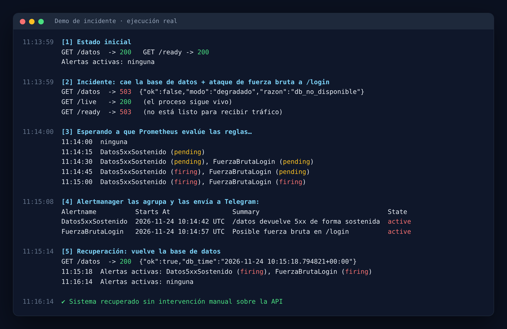
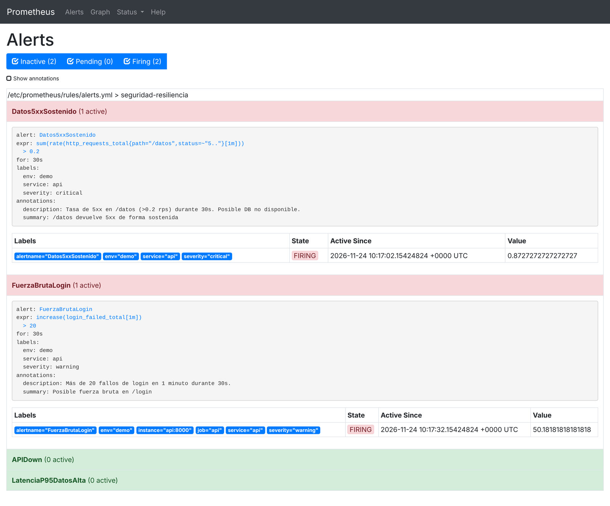
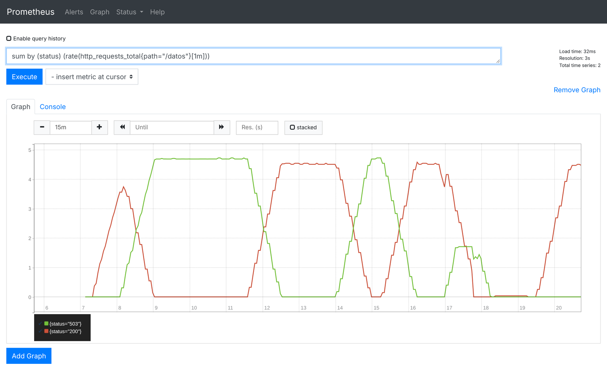
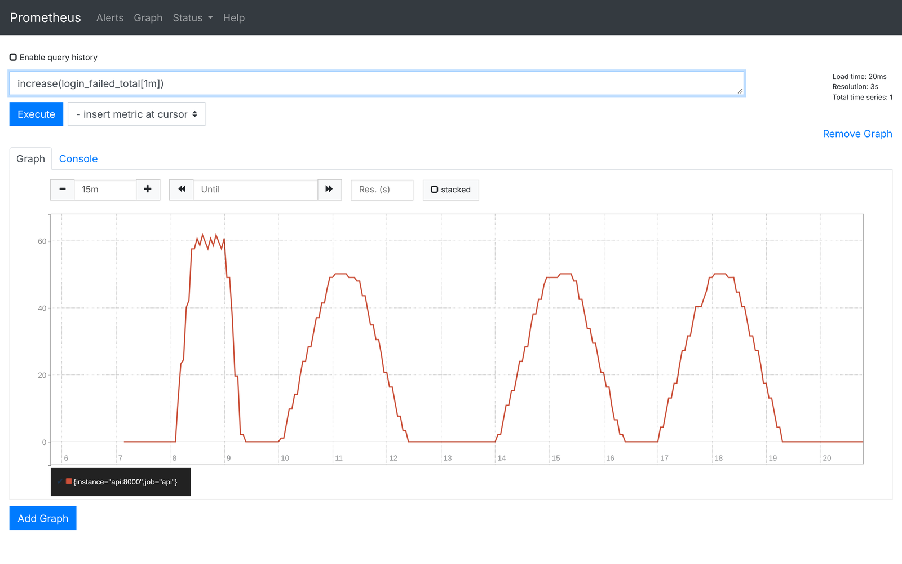

# 🛡️ Seguridad y resiliencia con Docker y observabilidad

Entorno dockerizado que **provoca fallos reales** (caída de la base de datos, ataques de fuerza bruta) y comprueba
que el sistema los **detecta, avisa y se recupera solo**, como se haría en un ejercicio de *chaos engineering*.

Incluye una API detrás de un proxy Nginx endurecido, PostgreSQL y un stack completo de observabilidad:
**Prometheus** para métricas y reglas, **Alertmanager** para avisar por **Telegram** y **Grafana** para los dashboards.



*Ejecución real de la demo: cae la base de datos y llega un ataque de fuerza bruta. En 45 s salta la primera alerta,
Alertmanager las agrupa y, cuando vuelve la base de datos, todo se resuelve sin tocar la API.*

---

## 🧱 Arquitectura

```
                       ┌──────────────────────── red interna (appnet) ────────────────────────┐
 Usuario ──:80──▶  Nginx (proxy)  ──▶  API FastAPI  ──▶  PostgreSQL
                 rate limiting          │  /metrics
                 cabeceras seguras      ▼
                                   Prometheus ──▶ Alertmanager ──▶ Telegram
                                        │
                                        └──▶ Grafana (:3000)
                       └───────────────────────────────────────────────────────────────────────┘
```

Solo el proxy está expuesto al exterior: la API no publica su puerto y `/metrics` no es accesible desde fuera.

## 🔒 Seguridad

- **Un único punto de entrada:** la API no publica puertos; todo pasa por Nginx.
- **Rate limiting:** 5 peticiones/s en `/login` (ráfaga de 10) y 30/s en el resto; por encima, responde `429`.
- **`/metrics` interno:** Nginx devuelve `404`. Prometheus lee las métricas directamente dentro de la red de Docker.
- **Cabeceras de seguridad** (`X-Frame-Options`, `X-Content-Type-Options`, `Referrer-Policy`), versión de Nginx oculta y tamaño máximo de petición.
- **Contenedores endurecidos:** la API corre con un usuario sin privilegios, con sistema de ficheros de solo lectura, sin *capabilities* y con `no-new-privileges`.
- **Errores sin filtrar información:** si cae la base de datos, el cliente recibe un `503` en «modo degradado»; el detalle solo va al log interno.
- **Métricas a prueba de abuso:** las métricas usan la plantilla de la ruta y agrupan las URLs desconocidas, así que nadie puede crear miles de series en Prometheus pidiendo URLs inventadas.
- **Secretos fuera del repositorio:** el token de Telegram vive en `.env`; `alertmanager.yml` se genera a partir de una plantilla y está en `.gitignore`.

## ❤️ Resiliencia

- **Liveness** (`/live`) y **readiness** (`/ready`, comprueba la base de datos) por separado: el proceso sigue vivo aunque no esté listo para recibir tráfico.
- **Timeouts cortos** con la base de datos (1 s para conectar, 800 ms por consulta): la API no se queda colgada si la BD está congelada.
- **Health checks** en Docker Compose y reinicio automático (`restart: unless-stopped`).

## 📈 Observabilidad y alertas

| Alerta | Cuándo salta | Severidad |
|---|---|---|
| `APIDown` | Prometheus no puede leer la API durante 30 s | crítica |
| `Datos5xxSostenido` | `/datos` devuelve más de 0,2 errores 5xx por segundo durante 30 s | crítica |
| `FuerzaBrutaLogin` | Más de 20 logins fallidos en un minuto, mantenido durante 30 s | aviso |
| `LatenciaP95DatosAlta` | El percentil 95 de la latencia de `/datos` supera 1 s durante 1 min | aviso |

Hay dos juegos de reglas: `alerts.yml` (demo, reacciona en segundos) y `alerts.prod.yml` (umbrales más tolerantes, para no generar ruido).

| Alertas activas en Prometheus | Errores en `/datos` durante tres caídas de la BD |
|---|---|
|  |  |



*Logins fallidos por minuto durante los ataques simulados. En el primero, Nginx cortó con un 429 la mayoría de los intentos (48 de 60).*

## 💥 Chaos engineering

| Script | Qué hace |
|---|---|
| `chaos/kill_db.sh` · `chaos/revive_db.sh` | Congela y recupera la base de datos |
| `chaos/wait_db_healthy.sh` | Espera a que la BD vuelva a estar sana |
| `chaos/bruteforce_login.sh` | Ataque de fuerza bruta contra `/login` |
| `chaos/demo_incidente_db.sh` · `chaos/demo_incidente_login.sh` | Incidente completo: fallo → alerta → recuperación |
| `chaos/demo_all.sh` | Toda la demo de una vez |

Cada ejecución guarda **evidencias** con fecha en `evidencias/` (salud inicial, incidente, recuperación,
alertas activas en Prometheus y Alertmanager y logs del proxy), como se haría para un post-mortem.

---

## 🚀 Puesta en marcha

Requisitos: Docker con Docker Compose v2 y Make.

```bash
cp .env.example .env      # rellena TELEGRAM_BOT_TOKEN, TELEGRAM_CHAT_ID y la contraseña de Grafana
make up                   # genera la config de Alertmanager y levanta todo
make demo                 # ejecuta la demo de incidentes
make down
```

| Servicio | URL |
|---|---|
| API (a través del proxy) | http://localhost |
| Prometheus | http://localhost:9090 |
| Alertmanager | http://localhost:9093 |
| Grafana | http://localhost:3000 (usuario `admin`) |

### Endpoints de la API

| Ruta | Descripción |
|---|---|
| `GET /estado` | Estado básico del servicio |
| `GET /live` | Liveness (no depende de la BD) |
| `GET /ready` | Readiness (comprueba la BD) |
| `GET /datos` | Consulta a la BD; `503` en modo degradado si no está disponible |
| `POST /login` | Login de demo (`DEMO_USER` / `DEMO_PASSWORD`, por defecto `admin`/`admin`) |
| `GET /metrics` | Métricas de Prometheus (solo dentro de la red interna) |

## 🧪 Calidad

```bash
make test     # tests de la API con pytest (sin base de datos real)
make check    # valida docker-compose y las reglas de Prometheus
```

GitHub Actions ejecuta en cada push los tests, `docker compose config`, `promtool check rules`,
`amtool check-config`, `nginx -t` y el build de la imagen de la API.

## 🛠️ Tecnologías

Docker · Docker Compose · Nginx · Python 3.12 · FastAPI · PostgreSQL 16 · Prometheus · Alertmanager · Grafana ·
pytest · GitHub Actions · Bash · Make

## 📚 Qué he aprendido

- Diseñar un entorno con proxy, API, base de datos y observabilidad, exponiendo solo lo imprescindible.
- Escribir alertas útiles (disponibilidad, errores, seguridad y latencia) y ajustarlas para no generar ruido.
- Provocar fallos de forma controlada y documentar cómo responde el sistema.
- Que la observabilidad también tiene su propia superficie de ataque: métricas públicas o con etiquetas sin control.
